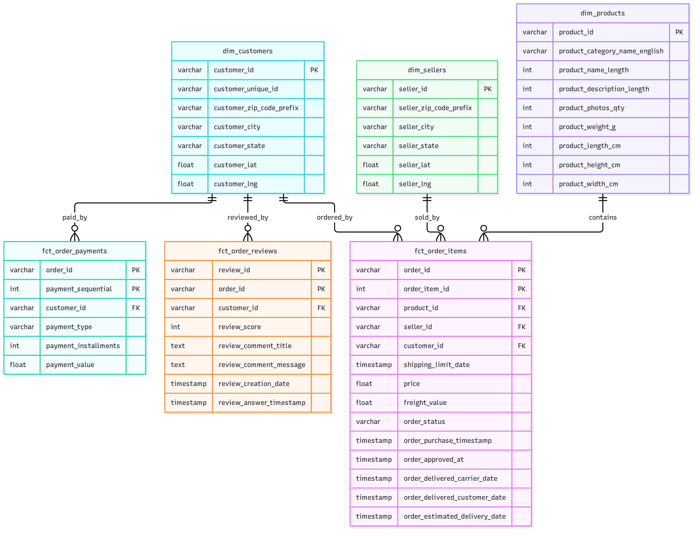
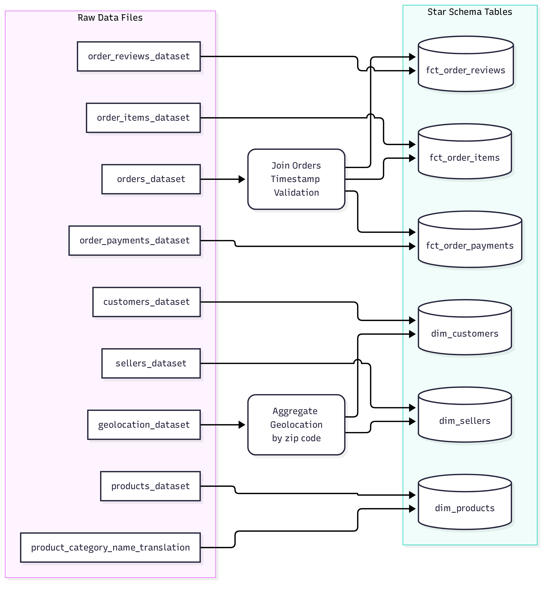
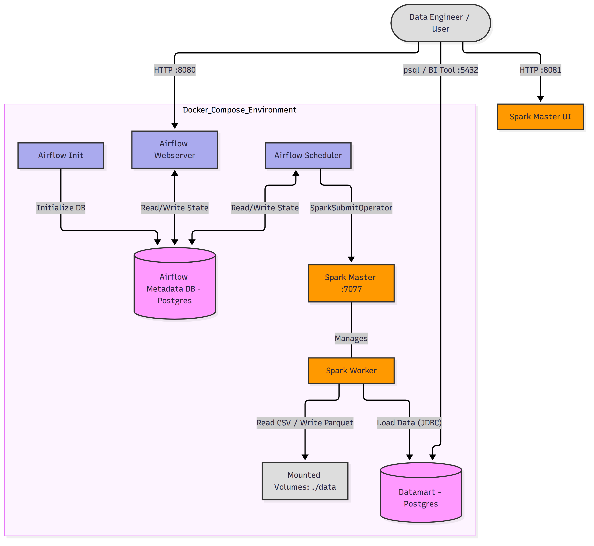
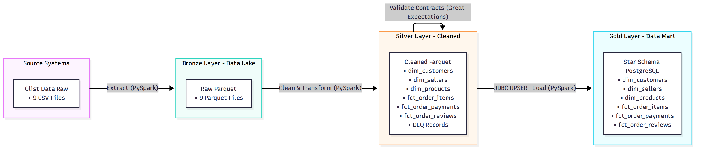

# End-to-End E-Commerce ETL Pipeline with PySpark

Yêu cầu: xây dựng ETL Pipeline hoàn chỉnh dựa trên dữ liệu E-commerce (`data/raw`).
Gợi ý: Ngoài tự thiết kế học viên có thể tham khảo một khung kiến trúc mẫu bên dưới nhưng cần hoàn thành các đoạn code còn thiếu (được đánh dấu bằng `# TODO`) để cài đặt ETL cho một luồng dữ liệu chuẩn Medallion Architecture sử dụng **Apache Spark** thay cho Pandas/Polars.

## Mục tiêu học tập

1. Áp dụng kiến trúc **Medallion (Bronze, Silver, Gold)**.
2. Xây dựng DAG bằng **Apache Airflow** để điều phối toàn bộ workflow, sử dụng `SparkSubmitOperator`.
3. Sử dụng **PySpark** để xử lý dữ liệu lớn, tận dụng khả năng phân tán.
4. Áp dụng các quy tắc **Data Contract** (VD: `price > 0`, kiểm tra null) và quản lý dữ liệu lỗi qua **DLQ (Dead Letter Queue)**.
5. Áp dụng **Great Expectations** trực tiếp trên Spark DataFrame để kiểm tra chất lượng dữ liệu.
6. Thiết kế Data Mart theo **Star Schema** trên **PostgreSQL** và xử lý kỹ thuật **UPSERT** qua kết nối JDBC và thư viện `psycopg2`.




## Kiến trúc mẫu (Infrastructure Architecture)

Hệ thống được thiết lập dựa trên Docker Compose với sơ đồ hạ tầng như sau:




- **Airflow Environment**:
  - **Webserver (Port 8080) & Scheduler**: Hai thành phần chính quản lý và thực thi DAG.
  - **Metadata DB (Postgres)**: Database trung tâm chứa siêu dữ liệu của Airflow.
  - Tích hợp sẵn môi trường Java và PySpark để chạy `SparkSubmitOperator` ở Local Mode (hoặc Standalone cluster).
- **Datamart DB**: Database PostgreSQL chạy ở Port 5432, đóng vai trò Data Mart lưu trữ kết quả đầu ra (Gold layer).
- **Local Filesystem (`./data`)**: Volume được mount vào Airflow chứa dữ liệu Raw, và thư mục lưu trữ Bronze, Silver, DLQ (dưới định dạng Parquet).

## Cấu trúc thư mục hiện tại

```text
lab15-student-assignment/
├── dags/
│   └── ecommerce_etl_spark_dag.py  <-- TODO: Khai báo SparkSubmitOperator và dependencies
├── data/
│   └── raw/                        <-- Chứa dữ liệu CSV nguồn
├── img/
├── sql/
│   └── init_db.sql                 <-- TODO: Viết lệnh DDL tạo các bảng cho Gold schema
├── src/
│   └── spark_etl.py                <-- TODO: Viết logic Extract, Transform, Data Quality, Load bằng PySpark
├── docker-compose.yml
├── Dockerfile
└── requirements.txt
```

## Các bước thực hiện (Hướng dẫn làm bài)

### Bước 1: Khởi tạo và thiết lập CSDL

1. Mở file `sql/init_db.sql`.
2. Dựa vào các TODO comments, hãy hoàn thành các lệnh `CREATE TABLE` để thiết lập Star Schema (gồm các Dimension tables: products, sellers và Fact tables: order_items, order_payments, order_reviews).
3. Thêm các index cần thiết để tăng tốc độ truy vấn.

### Bước 2: Hoàn thiện Airflow DAG

1. Mở file `dags/ecommerce_etl_spark_dag.py`.
2. Khai báo các `SparkSubmitOperator` tương ứng với từng layer: Extract (Bronze), Transform (Silver), Data Quality, và Load (Gold).
3. Truyền đúng `application_args` (ví dụ `['--layer', 'bronze']`) để chạy đúng function trong `spark_etl.py`.
4. Với task Load to Gold, nhớ thêm tham số `packages='org.postgresql:postgresql:42.5.4'` để Spark có thể tải JDBC driver kết nối với PostgreSQL.
5. Liên kết các task lại với nhau theo đồ thị dependencies:
   `start >> extract >> transform >> data_quality >> load >> report >> end`

### Bước 3: Viết logic Extract (Bronze Layer)

1. Mở file `src/spark_etl.py`.
2. Trong hàm `extract_to_bronze(spark)`, điền code vào vị trí `TODO` để sử dụng `spark.read.csv` đọc các file CSV. Nên sử dụng tham số `header=True`, `inferSchema=True`.
3. Lưu dữ liệu dưới định dạng Parquet (mode `overwrite`) vào thư mục `/opt/airflow/data/bronze`.

### Bước 4: Viết logic Transform (Silver Layer & Data Contract)

1. Trong hàm `clean_to_silver(spark)` của `src/spark_etl.py`, đọc các file Parquet từ Bronze layer.
2. Thực hiện làm sạch dữ liệu:
   - Loại bỏ trùng lặp (duplicate).
   - Chuyển đổi định dạng timestamp.
   - Join các bảng với nhau (như hợp nhất thông tin địa lý vào customer và seller).
3. **Data Contract**:
   - Khi xử lý `fct_order_items`, đảm bảo `price > 0` và `freight_value >= 0`.
   - Những dòng không thỏa mãn điều kiện, thay vì bỏ đi, hãy lưu vào thư mục DLQ (`/opt/airflow/data/dlq`) dưới dạng append.

### Bước 5: Viết logic Data Quality (Great Expectations)

1. Trong hàm `check_quality(spark)`, đọc dữ liệu Silver layer và bọc trong `SparkDFDataset`.
2. Hoàn thiện các TODO để kiểm tra:
   - Bảng `dim_customers` không được rỗng, `customer_id` không được null và phải duy nhất.
   - Cột `order_status` trong `fct_order_items` phải nằm trong tập giá trị hợp lệ.
3. Kiểm tra số lượng record trong DLQ không được vượt quá 10% tổng số record.

### Bước 6: Viết logic Load (Gold Layer bằng UPSERT)

1. Trong hàm `load_to_gold(spark)`, thực hiện kỹ thuật Upsert vào PostgreSQL.
2. Spark mặc định khi `df.write.jdbc(mode='overwrite')` sẽ DROP bảng PostgreSQL và tạo lại, làm mất Schema và Constraint. Do đó, chúng ta sẽ ghi df vào một **bảng tạm (temp table)** trên Postgres bằng Spark JDBC.
3. Sau đó, dùng thư viện `psycopg2` để gửi câu lệnh RAW SQL: `INSERT INTO target_table SELECT * FROM temp_table ON CONFLICT (pk) DO UPDATE SET ...` để Upsert dữ liệu từ bảng tạm sang bảng thật.
4. Xóa bảng tạm sau khi hoàn tất.

## Hướng dẫn chạy và kiểm tra (Testing)

Sau khi điền đủ code, làm theo các bước sau để chạy Pipeline:

**1. Khởi tạo Airflow metadata và tài khoản mặc định (admin/admin):**

```bash
docker-compose up airflow-init
```

**2. Bật các service:**

```bash
docker-compose up -d
```

**3. Chạy DAG:**

- Mở trình duyệt và truy cập `http://localhost:8080`.
- Đăng nhập bằng `admin` / `admin`.
- Tìm DAG `ecommerce_etl_spark`, unpause và bấm **Trigger DAG**.
- Theo dõi các task. Có thể bấm vào Log của từng `SparkSubmitOperator` để xem quá trình Spark xử lý.

**4. Kiểm tra kết quả trong Data Mart:**

```bash
# Kết nối vào Postgres container
docker-compose exec datamart psql -U admin -d ecommerce

# Chạy một vài câu SQL để kiểm tra
ecommerce=# SELECT COUNT(*) FROM gold.dim_customers;
ecommerce=# SELECT * FROM gold.fct_order_items LIMIT 5;
```
